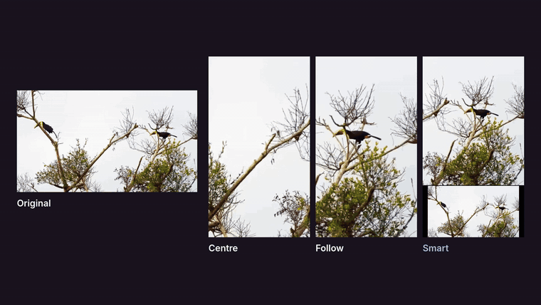
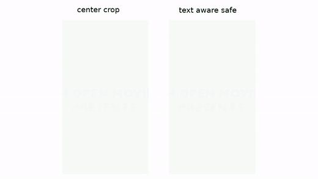
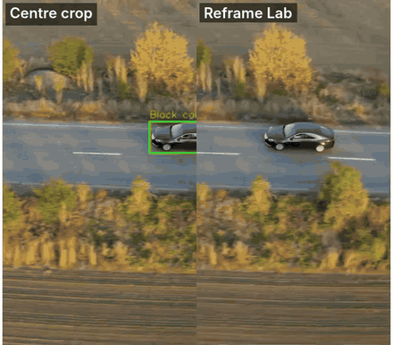
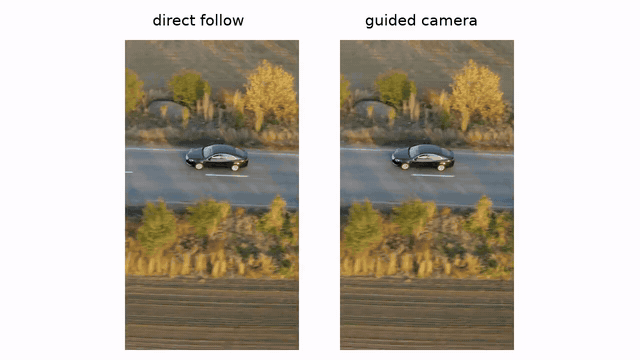
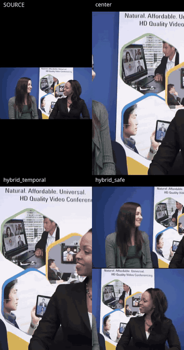
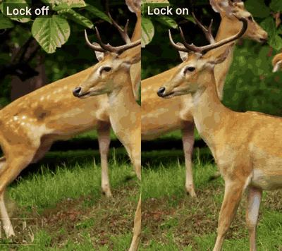
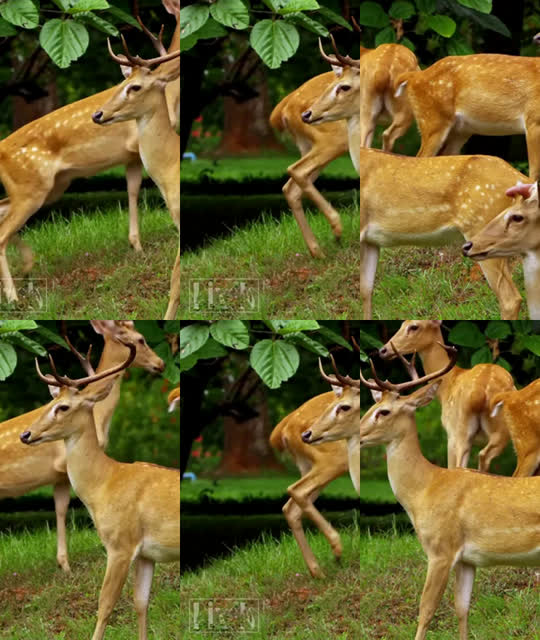
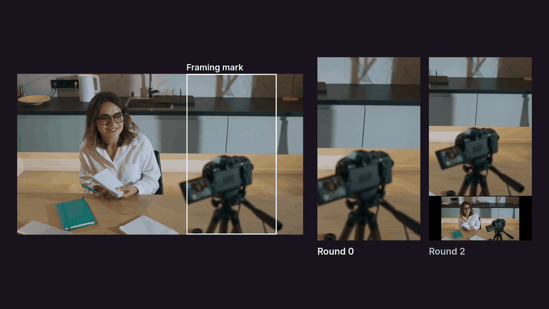

<picture>
  <source media="(prefers-color-scheme: dark)" srcset="docs/images/logo/reframe-lab-logo-dark.svg">
  
</picture>

# Reframe Lab

Reframe Lab turns a landscape video into a Short, a square post or any other size, while keeping the important parts in the frame. I built it with OpenCV 5 to turn my own YouTube videos into Shorts.

It finds faces, people, text and motion in each frame, plans a calm camera path, and checks its own plan before rendering. You then see every edit side by side and download the one you like.

<p align="center"></p>

## Run it locally

You need Python 3.10 or newer and FFmpeg.

```bash
python3 -m venv .venv
source .venv/bin/activate
pip install -e '.[cloud]'
reframe-lab models --download core
reframe-lab web
```

Then open http://127.0.0.1:8000. Drop a video or press *Try a sample clip*, then press **Reframe**.

You can also run it from the command line:

```bash
reframe-lab demo input.mp4 --output runs/vertical --output-size 1080x1920
```

Each run saves the videos, the crop plans, a report and a trace of every decision the review step made.

## Deploy on AWS

```bash
./deploy/aws/deploy.sh
```

The setup and settings are in [`docs/AWS.md`](docs/AWS.md).

## Run the tests

```bash
pip install -e '.[dev,cloud]'
pytest
```

The tests pass on Python 3.10 to 3.14. To install the exact package versions I tested with, add `-c requirements/dev.lock` (Python 3.12 or newer). The AWS worker image installs from `requirements/runtime.lock`.

## How it works

The [technical report](docs/TECHNICAL_REPORT.md) covers the OpenCV pipeline, the camera planner, the review loop, the AWS setup and the results.

- `src/reframelab/` holds the app.
- `web/page.template.html` is the web page. `scripts/build_web_pages.py` builds the local and AWS pages from it.
- `deploy/aws/` holds the AWS template, worker image, API function and sample clip.
- `tests/` holds the tests.
- `docs/` holds the technical report, the AWS guide, images and the review loop evidence.
- `evaluation/` holds the result videos, plans and metrics from every test.

## Results

### Keeping the important content

On the wildlife sample at the top of this page, the centre crop keeps about 29% of the important content in view. *Smart* keeps about 79%, since it finds the animal in each shot.

### Keeping text whole

<p align="center"></p>

Text was very important for me, since a word with letters missing is hard to read. On the Big Buck Bunny trailer, the centre crop cuts the title card on both sides. *Smart* adds a second view with the whole title, and kept 0.975 of the text whole.

### Following a moving car

<p align="center"></p>

The car drives across the frame from right to left. The centre crop starts with the car half cut off and loses it completely by the end. Reframe Lab follows the car and keeps all of it in frame until the end. (The green box on the left is the tracker's preview, drawn on the source.)

### A calm camera

<p align="center"></p>

My first version moved the camera straight to wherever the tracker put the car. This caused the frame to twitch at every small change. Now the tracker only reports positions, and a separate planner moves the camera with low jerk. Compared with my earlier controller, mean jerk on the car clip fell from 1.961 to 0.178, and the car stayed in frame the whole time.

### Two people far apart

<p align="center"></p>

When two people sit far apart, one narrow crop has to guess. The split layout kept both people in view for the whole clip, and the same worked for four people.

### Same framing on repeated shots

<p align="center"> </p>

Edited videos often cut back to the same camera angle. The video plays the edit with the lock off on the left and on on the right. The still shows the first frame of each return. Without the lock, the crop opened in a different place each time (top row). With it, matching shots open in nearly the same place (bottom row). The spread of the opening crops fell from 0.411 to 0.028 crop widths.

### The review loop fixing a bad plan

<p align="center"></p>

In this test, I put a framing mark on a camera instead of the woman next to it. The first plan scored 42 and lost her. The review loop saw the low coverage and changed the layout settings twice. In the second round, it switched to a context and detail layout. The score rose to 74.

### Speed

To speed it up, unchanged scenes reuse their earlier results and the video is encoded once. On a 45 second screen recording, a run went from 17.11 s to 11.99 s with the same output.

All the videos, plans and metrics behind these results are in [`evaluation/`](evaluation/).
