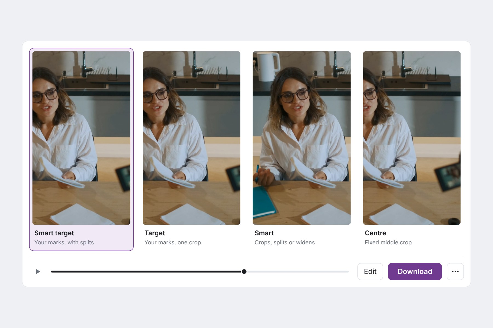

<picture>
  <source media="(prefers-color-scheme: dark)" srcset="docs/images/logo/reframe-lab-logo-dark.svg">
  
</picture>

# Reframe Lab

Reframe Lab turns a landscape video into a Short, a square post or any other size, while keeping the important parts in the frame. I built it with OpenCV 5 to turn my own YouTube videos into Shorts.

It finds faces, people, text and motion in each frame, plans a calm camera path, and checks its own plan before rendering. You then see every edit side by side and download the one you like.



## Run it locally

```bash
python3 -m venv .venv
source .venv/bin/activate
pip install -c requirements/runtime-py312.lock -e '.[cloud]'
reframe-lab models --download core
reframe-lab web
```

Then open http://127.0.0.1:8000. Drop a video or press *Try a sample clip*, then press **Reframe**.

You can also run it from the command line:

```bash
reframe-lab demo input.mp4 --output runs/vertical --output-size 1080x1920
```

Each run saves the videos, the crop plans, a report and a trace of every decision the review step made.

## Deploy on AWS

```bash
./deploy/aws/deploy.sh
```

The setup and settings are in [`docs/AWS.md`](docs/AWS.md).

## Run the tests

```bash
pip install -c requirements/dev-py312.lock -e '.[dev,cloud]'
pytest
```

## How it works

The [technical report](docs/TECHNICAL_REPORT.md) covers the OpenCV pipeline, the camera planner, the review loop, the AWS setup and the results.

| Folder | What it holds |
| --- | --- |
| `src/reframelab/` | The app |
| `web/page.template.html` | The web page. `scripts/build_web_pages.py` builds the local and AWS pages from it. |
| `deploy/aws/` | The AWS template, worker image, API function and sample clip |
| `tests/` | The tests |
| `docs/` | The technical report, the AWS guide, images and the review loop evidence |
