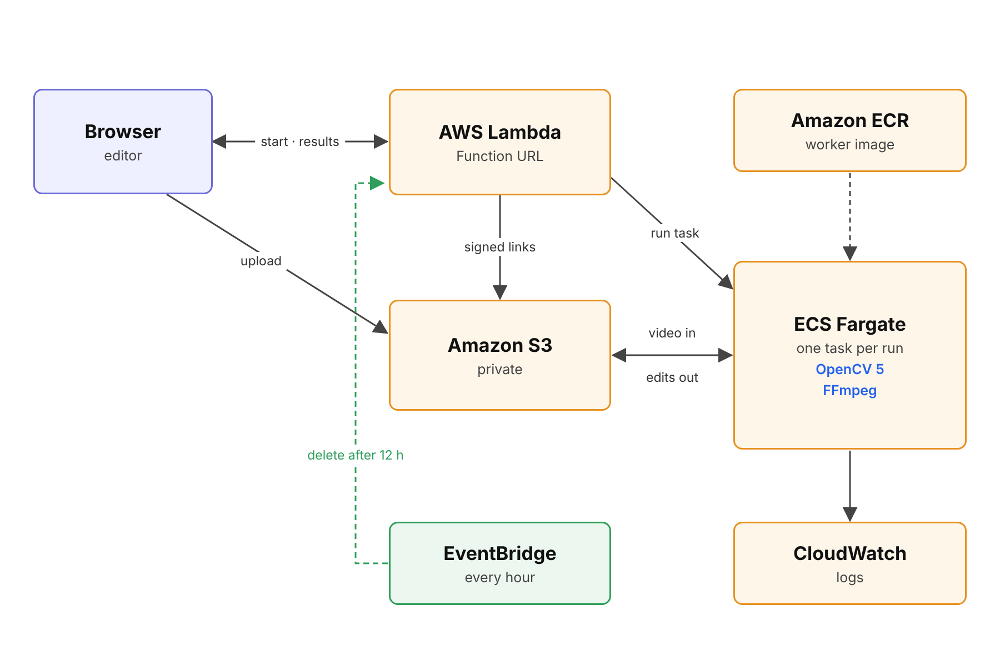

# Deploying on AWS

To save resources, nothing runs on AWS when no one is using the site. The browser uploads the video straight to a private S3 bucket. A Lambda function URL then starts one ECS Fargate task for that video. The task runs OpenCV 5 and FFmpeg, writes the edits back to S3 and stops. Meanwhile, the page polls Lambda and plays the results from links that expire after one hour.



## What you need

- AWS CLI v2 and AWS SAM CLI
- Docker with buildx
- Python 3.10 or newer
- AWS credentials that can create CloudFormation, IAM, VPC, ECS, ECR, Lambda, S3 and CloudWatch resources

## Deploy

```bash
./deploy/aws/deploy.sh
```

The script builds the worker image from `deploy/aws/Dockerfile` with the three core models inside. It pushes the image to a private ECR repository and deploys the stack in `deploy/aws/template.yaml`. The task definition points at the image digest, so a job always runs the exact image that was built. The script also copies the sample clip to the bucket.

When it finishes, it prints the web URL and an access code. Both are saved in `.aws-deploy.env`, which Git ignores since it holds the access code. Running the script again updates the stack and keeps the same access code.

You can change these settings when you run it:

| Setting | Default |
| --- | --- |
| `AWS_REGION` | Your AWS CLI region, or `us-east-1` |
| `STACK_NAME` | `reframe-lab` |
| `ACCESS_CODE` | A new random code |
| `RETENTION_HOURS` | `12` |
| `MAX_UPLOAD_BYTES` | `4294967296` (4 GiB) |
| `DOWNLOAD_CORE_MODELS` | `1` |

```bash
AWS_REGION=eu-west-2 STACK_NAME=reframe-demo ./deploy/aws/deploy.sh
```

## Use it

Open the web URL, drop a video, enter the access code and press **Reframe**. *Try a sample clip* shows the pre-rendered wildlife edits without an upload or an access code.

Marks made in the editor travel with the job, and the worker renders the target edits too. The cloud page skips the tracking review step that the local app runs.

## Data retention

Once an hour, EventBridge runs a cleanup in the API function. It deletes uploads and results older than twelve hours, since nothing needs them after that. An S3 lifecycle rule deletes the same files after one day, in case a cleanup run fails. The sample clip is never deleted.

## Logs

The worker writes JSON events to CloudWatch, such as `job_started`, `job_completed` and `job_failed`.

```bash
source .aws-deploy.env
LOG_GROUP=$(aws cloudformation describe-stacks \
  --stack-name "$STACK_NAME" --region "$AWS_REGION" \
  --query 'Stacks[0].Outputs[?OutputKey==`WorkerLogGroupName`].OutputValue' \
  --output text)
aws logs tail "$LOG_GROUP" --follow --region "$AWS_REGION"
```

If a task stops before it writes a result, the API reads the ECS stop reason and shows it on the page.

## Remove it

```bash
./deploy/aws/destroy.sh
```

The script empties the bucket and deletes the stack. Add `DELETE_ECR_REPOSITORY=1` to delete the image repository too.

## Security

This is a private demo. Every API call needs the access code, and uploads have a size limit. The bucket blocks public access, and the tasks accept no inbound traffic. A public service would also need user accounts, rate limits, private subnets and upload scanning.
