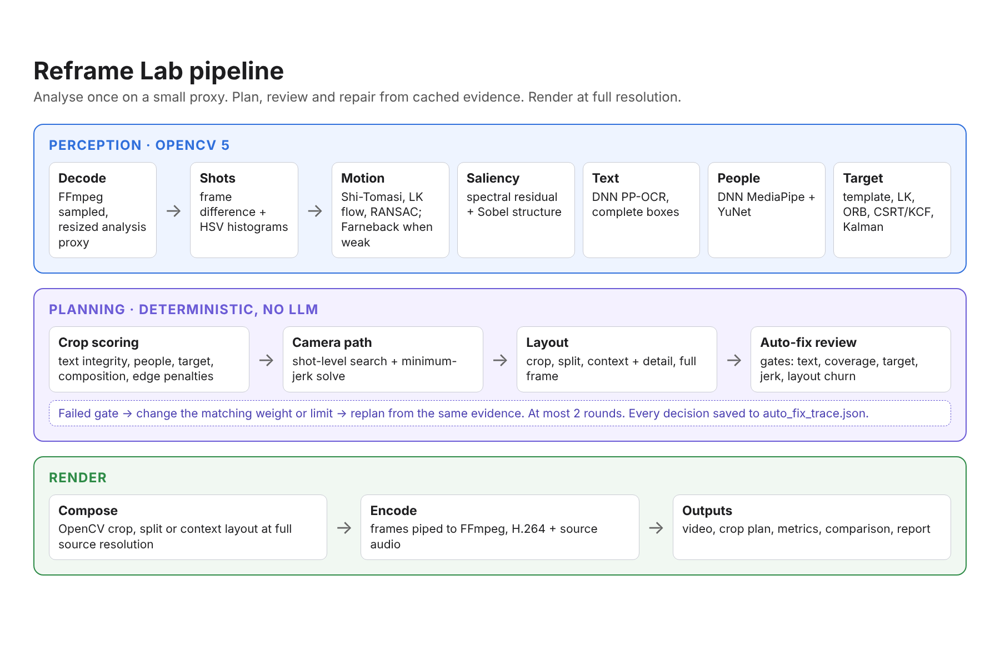
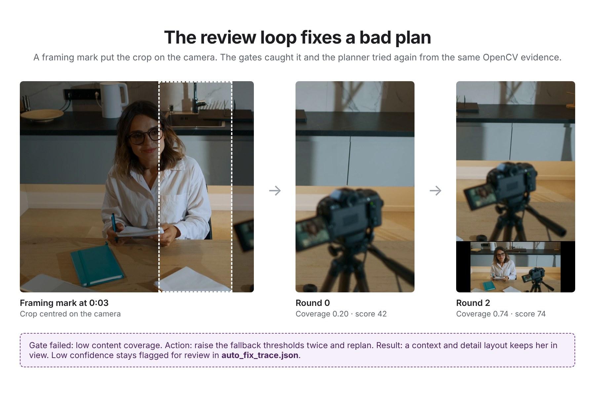

# Reframe Lab: technical report

Reframe Lab converts a video to any output size and keeps the important content in frame. Portrait, square, landscape, ultrawide and custom sizes all use the same geometry code. A run renders every edit (*Smart*, *Follow* and *Centre*, plus *Smart target* and *Target* when the user marks something) along with the crop plans, metrics and a decision trace.

## Pipeline

The pipeline has three stages.

1. Perception. FFmpeg samples and resizes the frames into a small analysis copy. OpenCV 5 finds the shots, measures motion and visual prominence, and runs three DNN models. The results are cached as one analysis bundle.
2. Planning. A scorer rates candidate crop windows on every sampled frame. A planner picks a smooth path through each shot and chooses a layout. A review loop checks the plan and repairs it before rendering.
3. Render. OpenCV composes each output frame from the full-resolution source. Frames are piped straight into FFmpeg for H.264 with the source audio, and all edits are rendered in one decode pass.

Corrections and edit changes replan from the cached bundle, so they skip the perception stage.

## OpenCV 5 methods

| Stage | Method |
|---|---|
| Shot detection | Grey frame difference and HSV histogram distance (`cv.calcHist`, `cv.compareHist`) |
| Camera motion | Shi-Tomasi corners, pyramidal Lucas-Kanade flow, `cv.estimateAffinePartial2D` with RANSAC |
| Motion in low-texture scenes | Farneback dense flow, used only when sparse motion is unreliable |
| Visual prominence | Spectral residual saliency built on `cv.dft`, plus Sobel structure |
| Text | PP-OCR text detection through `cv.dnn`, kept as whole boxes |
| People and faces | MediaPipe person detection and YuNet face detection through `cv.dnn` |
| Selected target | Template matching, Lucas-Kanade flow, ORB with RANSAC reacquisition, CSRT or KCF, Kalman prediction |
| Active speaker | Farneback flow on the lower face, combined with audio energy |
| Repeated shots | HSV histograms and Sobel edge profiles, compared by cosine similarity |

The DNN runtime times each OpenCV 5 DNN engine (new, auto, classic and ONNX Runtime) on a sample input. It keeps the fastest engine that returns valid output, keeps the models loaded and sends frames in batches. If a batch fails, it falls back to single frames.

RAFT, Depth Anything V2, EfficientSAM and ViTTrack sit behind an experimental flag. On the benchmark clips they did not beat the classical path by enough to justify their cost. For example, RAFT read moving trees and road parallax as object motion and did worse than Lucas-Kanade on the car clip.

## Camera planning

For each sampled frame, the scorer rewards retained saliency, residual motion, structure, whole text, people and the selected target. It penalises clipped regions and content near the edge. A dynamic program picks a path through each shot. A second solve smooths the crop centre $x_t$ with a minimum-jerk objective:

$$
\min_{x} \sum_t w_t \left(x_t - d_t\right)^2 + \lambda_v \sum_t \left(\Delta x_t\right)^2 + \lambda_a \sum_t \left(\Delta^2 x_t\right)^2 + \lambda_j \sum_t \left(\Delta^3 x_t\right)^2
$$

$d_t$ is the centre the scorer wanted. The path then passes hard limits on speed, acceleration and jerk, and planning resets at every shot boundary.

The tracker never moves the crop directly. It only reports positions to the planner. Initially, the tracker drove the crop, and this caused the frame to twitch at every small change in its box.

When one crop cannot hold the content, the layout stage switches to a split, a context and detail view, or the full frame. Text is scored as whole boxes, so a label that is 90% visible counts as cut.

Repeated camera angles are grouped when their appearance similarity is at least 0.90. The first 0.8 s of each shot in a group is pulled 90% of the way toward the group's median opening crop. Real movement later in the shot is still planned normally.

## Review loop

Before rendering, a controller checks each plan against quality gates for whole text, low-tail content coverage, target visibility, camera jerk, layout changes per minute and confidence. Each failed gate maps to one change in the planning parameters. For example, a text failure raises the text weight and allows an earlier split. The planner then replans from the same cached evidence. The loop runs at most two extra rounds (to avoid looping forever) and keeps the best plan. Every measurement and decision goes into `auto_fix_trace.json`, and remaining low-confidence issues stay in the trace for review.

In the example above, a framing mark put the crop on a camera instead of the person. Round 0 scored 42 with a 10th-percentile coverage of 0.20. The coverage gate raised the fallback thresholds twice. In round 2 the planner switched to a context and detail layout, coverage rose to 0.74 and the score rose to 74. The trace and frames are in [`evidence/auto-fix-example/`](evidence/auto-fix-example/).

The loop runs on OpenCV measurements and fixed rules, with no language model.

## Performance

To cut repeated work, the analysis copy is sampled by FFmpeg before Python sees it. Difficult intervals get a finer second pass, and OCR and person detection run on their own cadence. Static scenes reuse their evidence until the next refresh or shot cut. The video is decoded and encoded once for all edits. Each run writes its stage timings to `performance.json`.

## AWS deployment

The browser gets a size-limited presigned POST from a Lambda function URL and uploads the video straight to a private S3 bucket. Lambda then starts one ECS Fargate task for that video. The task's image holds OpenCV 5, the three hash-checked models and FFmpeg, and it is pinned by digest in ECR. The worker writes the edits, plans and trace to S3 and stops. The browser polls Lambda and receives one-hour signed links. Every hour, EventBridge runs a cleanup that deletes uploads and results older than twelve hours. Worker logs go to CloudWatch as JSON events. If a task stops before it writes a result, the API reports the ECS stop reason.

The deployment steps are in [`AWS.md`](AWS.md).

## Evaluation

The benchmark clips are a Chromium timeline screencast with dense text, the KristenAndSara and FourPeople test sequences, a 4K moving car clip and the Big Buck Bunny trailer. The wildlife sample and the deer edit come from a wildlife compilation.

| Test | Baseline | Reframe Lab |
|---|---:|---:|
| Important content in view, wildlife sample | 0.291 (centre crop) | 0.791 (Smart) |
| Text kept whole, screen recording | 0.289 (centre crop) | 0.998 |
| Text visible somewhere in the frame | 0.467 (centre crop) | 1.000 |
| Mean camera jerk, car clip | 1.961 (direct follow) | 0.178 |
| 95th percentile camera jerk, car clip | 5.136 | 0.288 |
| Largest single-frame crop jump, Big Buck Bunny | 0.417 viewports | 0.073 viewports |
| Opening crop spread, controlled repeat test | 0.075 crop widths | 0.003 crop widths |
| Opening crop spread, deer edit | 0.411 crop widths | 0.028 crop widths |
| Run time, 45 s screen recording | 17.11 s | 11.99 s |

The minimum-jerk camera kept the same target coverage as the direct follower. On the screen recording, static-scene reuse skipped full analysis on 155 of 193 samples with identical quality metrics. On the moving car it reused none, since every frame had real motion.

These metrics are proxies computed from the same OpenCV evidence. They are not human ground truth, which is one reason every edit is shown to the user.

## Limitations

- In a busy interface, cursor tracking can jump to a similar shape and still report high confidence. Those frames are flagged for review.
- Text detection can miss very small, stylised or animated labels.
- Active-speaker emphasis has only been tested on a controlled clip, since the public two-person benchmark has no audio.
- A wrong framing mark can push the crop off the subject. The review loop catches low coverage but cannot know what the user meant.
- The cloud version skips the tracking review step, and a correction after a cloud run starts a new job.
